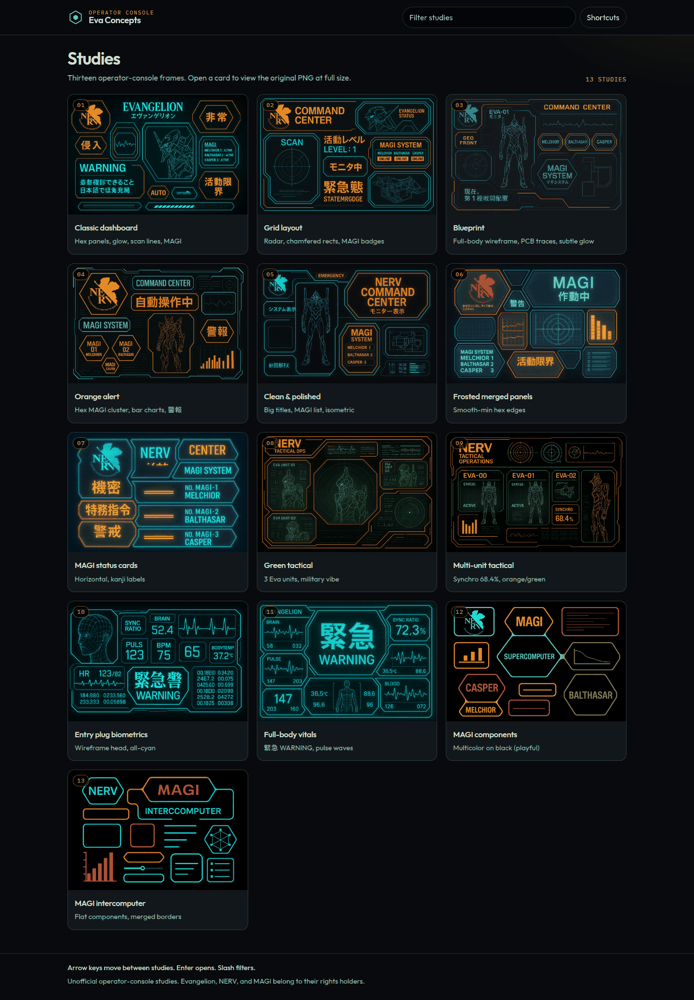
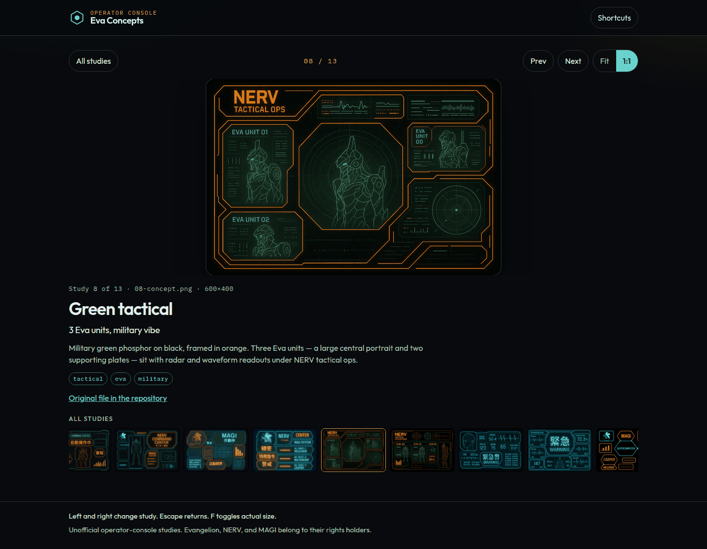
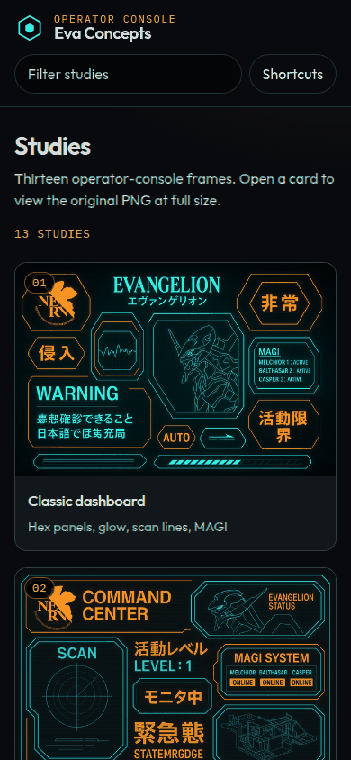
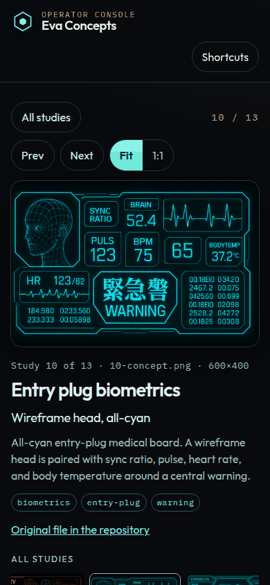

# Eva Concepts

A browsable gallery of thirteen operator-console UI studies. Each card and study page shows the original PNG from the repository root. The gallery is a wrapper: it does not edit those files.



Open a card for the full frame, the original index line, and a short description.



The same pages stack on a phone. Arrow keys, Enter, and Escape still move through the archive.





## Run it locally

```bash
npm install
npm run dev
```

The dev server prints a local URL. `npm run build` writes the static site to `dist/`, and `npm run preview` serves that folder. `npm run check` confirms every root concept PNG is catalogued and that the gallery’s routing and keyboard math still match the archive.

Study URLs are hashes, so a refresh keeps the frame you opened. `#/08` is the green tactical board. `#/` is the grid.

## Keyboard

| Key | Gallery | Study |
| --- | --- | --- |
| Arrow keys | Move between cards. Up and down follow the row. | Left and right change study |
| H J K L | Same movement | H and L change study |
| Enter | Open the focused card | |
| Home / End | First or last visible card | First or last study |
| F | | Toggle fit and actual size (600×400) |
| / | Focus the filter | Return to the filter |
| Esc | Clear the filter | Back to the gallery |
| ? | Shortcut list | Shortcut list |

The filter matches the number, title, summary, description, tags, and filename. “tactical” leaves studies 08 and 09. Arrow keys then stay inside that set.

## Catalog

Titles and summaries are the original selection index.

| # | Study | Summary |
| --- | --- | --- |
| 01 | Classic dashboard | Hex panels, glow, scan lines, MAGI |
| 02 | Grid layout | Radar, chamfered rects, MAGI badges |
| 03 | Blueprint | Full-body wireframe, PCB traces, subtle glow |
| 04 | Orange alert | Hex MAGI cluster, bar charts, 警報 |
| 05 | Clean & polished | Big titles, MAGI list, isometric |
| 06 | Frosted merged panels | Smooth-min hex edges |
| 07 | MAGI status cards | Horizontal, kanji labels |
| 08 | Green tactical | 3 Eva units, military vibe |
| 09 | Multi-unit tactical | Synchro 68.4%, orange/green |
| 10 | Entry plug biometrics | Wireframe head, all-cyan |
| 11 | Full-body vitals | 緊急 WARNING, pulse waves |
| 12 | MAGI components | Multicolor on black (playful) |
| 13 | MAGI intercomputer | Flat components, merged borders |

## Continuous integration

[`.github/workflows/ci.yml`](.github/workflows/ci.yml) runs on pull requests and on pushes to `main`. It installs dependencies, checks the catalog and navigation logic, builds the site, and confirms `dist/index.html` exists.

The catalog check fails if a root `*-concept.png` is missing from [`src/studies.json`](src/studies.json), or if a title or summary drifts from the index above. Image bytes are read only to confirm each file is still a 600×400 PNG.

## GitHub Pages

[`.github/workflows/pages.yml`](.github/workflows/pages.yml) publishes `dist/` with the official GitHub Pages actions. It runs on pushes to `main` and can also be started by hand.

One-time setup: in the repository settings, open **Pages** and set the source to **GitHub Actions**. After the first successful run, the site is at <https://newjordan.github.io/eva-concepts/>.

The Vite `base` is relative, so the same build works under `vite preview` and under that project path.

## Credits

- **Studies.** Thirteen concept frames added by Octavian for target selection. `01-concept.png` through `13-concept.png` are the source files. The site imports them and the build copies those bytes into `dist/`; the root files are left as they are.
- **Subject.** Unofficial studies in the visual language of Neon Genesis Evangelion. Evangelion, NERV, and MAGI belong to their rights holders. This repository is not affiliated with Khara or Gainax.
- **Gallery.** Static Vite site: dark theme, responsive grid, keyboard navigation, and one page per study.
- **Type.** [Outfit](https://fonts.google.com/specimen/Outfit) and [IBM Plex Mono](https://fonts.google.com/specimen/IBM+Plex+Mono), both under the SIL Open Font License, loaded through Fontsource.
